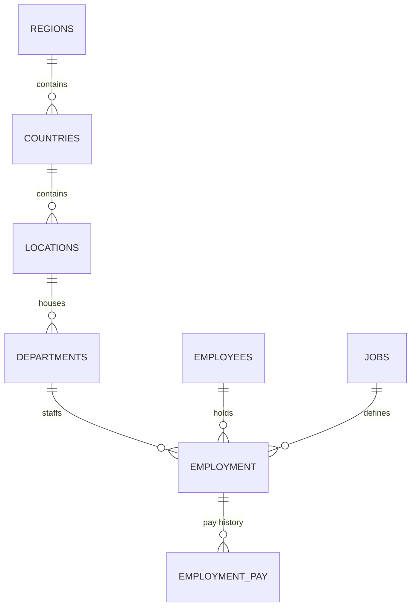

# Oracle HR Database

A human resources database built in Oracle for Database Management at Capitol Technology University, then rebuilt so anyone can run it end to end with sample data and reporting queries.

**Skills shown:** relational schema design, primary and foreign keys, check and unique constraints, indexing, PL/SQL triggers, views, window functions (`LEAD`, `LAG`, `RANK`), aggregation, and data validation.

## What it does

- **8 related tables** linked by **7 foreign keys**, covering regions, countries, locations, departments, employees, jobs, employment records, and pay history.
- **Audit triggers** on every table stamp who created each row and who last changed it, with the date.
- **Pay history without stored end dates.** Each raise is a new row. The `V_EMPLOYMENT` view uses `LEAD` to look at the next raise and gives each salary period an end date automatically.
- **Data rules enforced by the database:** salaries must be positive, commission must be between 0 and 1, a job's minimum pay cannot exceed its maximum, and emails must be unique.
- **Reporting queries** answer real HR questions: payroll by department, raise percentages, employees paid outside their band, top earner per department, and tenure.

## Schema



## Files

| File | Purpose |
|---|---|
| `sql/00_drop_all.sql` | Optional reset so the scripts can be rerun |
| `sql/01_schema.sql` | Tables, keys, constraints, and indexes |
| `sql/02_audit_triggers.sql` | One audit trigger per table |
| `sql/03_views.sql` | `V_EMPLOYEE`, `V_EMPLOYMENT`, `V_SALARY_VS_BAND` |
| `sql/04_sample_data.sql` | Fictional company with 8 employees and 16 pay records |
| `sql/05_reporting_queries.sql` | Six reporting queries |
| `original/hr_database_course_submission.sql` | The original script exported from SQL Developer Data Modeler for the course |

## How to run it

**Option 1, in the browser (no install):** open [FreeSQL](https://freesql.com) or [Oracle Live SQL](https://livesql.oracle.com), sign in, and run the files in `sql/` in order, 01 through 05.

**Option 2, on your own machine with Docker:**

```bash
docker run -d --name oracle-hr -p 1521:1521 \
  -e ORACLE_PASSWORD=ChangeMe123 \
  -e APP_USER=hr_app -e APP_USER_PASSWORD=ChangeMe123 \
  gvenzl/oracle-free
```

Then connect with SQL Developer or SQLcl to `localhost:1521/FREEPDB1` as `hr_app` and run the files in order.

## Sample results

**Who is paid outside their band?** (`05_reporting_queries.sql`, query 3)

| First | Last | Job | Salary | Band | Status |
|---|---|---|---|---|---|
| Quinn | Alvarez | IT Support Technician | 43,000 | 45,000 to 70,000 | Below band |
| Casey | Okafor | Financial Analyst | 93,000 | 60,000 to 90,000 | Above band |

**Raise history** (query 2, excerpt)

| Employee | Start | Salary | Prior | Raise |
|---|---|---|---|---|
| Avery Brooks | 2022-06-01 | 48,000 | | |
| Avery Brooks | 2023-06-01 | 52,000 | 48,000 | 8.3% |
| Avery Brooks | 2024-06-01 | 56,500 | 52,000 | 8.7% |
| Casey Okafor | 2024-11-01 | 93,000 | 71,000 | 31.0% |

**Payroll by department** (query 1)

| Department | City | Headcount | Payroll | Average |
|---|---|---|---|---|
| Information Technology | Laurel | 4 | 257,500 | 64,375 |
| Finance | Atlanta | 2 | 155,000 | 77,500 |
| Operations | London | 1 | 98,000 | 98,000 |
| Human Resources | Laurel | 1 | 57,000 | 57,000 |

## What changed from the course version

The original script in `original/` was generated by SQL Developer Data Modeler against a class server. To make it portable and correct, the rebuilt version:

- Removes the class account and storage settings so it runs in any schema.
- Generates primary keys automatically with `SYS_GUID()`.
- Replaces duplicate triggers, including two that were attached to the wrong table, with one clear audit trigger per table.
- Adds check and unique constraints, foreign key indexes, sample data, and reporting queries.

## Author

Jubril Hall-Robinson, B.S. Computer Engineering, Capitol Technology University
[jubrilhall-robinsonportfolio.dev](https://jubrilhall-robinsonportfolio.dev) | [LinkedIn](https://www.linkedin.com/in/jubrilhallrobinson)
